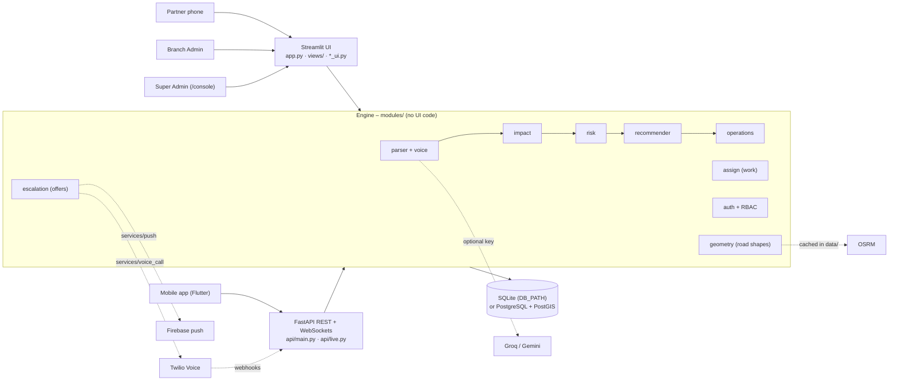

# DEPORT – Disruption-Aware Logistics Decision Support

> **From Disruption to Decision.** A delivery partner reports a road problem by voice; the branch admin sees the
> impact in seconds and fixes every affected route in one click.

[](https://github.com/vaiu0412/hack_inovix/actions/workflows/ci.yml)
· **Live demo:** <https://ripple-coimbatore.streamlit.app> · **Demo video:** _link coming soon_ ·
HackNext'26, Coimbatore (Team Inovix)

| Command Center | Live Map | Alerts – 3 steps | Partner: Report |
|---|---|---|---|
|  |  |  |  |

More in [`docs/screens/`](docs/screens/) · slides in [`docs/presentation/`](docs/presentation/)

## Problem
One accident on a main road delays many deliveries at once. Managers find out late, work out the impact by hand
and decide under pressure – so deadlines (even medicines) are missed.

## Solution
1. **Report** – the partner taps *Accident* and says or types it (Tamil, English or both). DEPORT finds the road,
   duration and severity, even when misspelled.
2. **See the impact** – the branch admin gets an alert: which deliveries are hit, which will be late, what is critical.
3. **Fix in one click** – a plan (backup vehicle, reroute, prioritise, notify) with a short reason per action.
   *Accept plan* updates routes, ETAs, the map, history and every partner's phone in one transaction.

Demo scenario (2-hour accident on Avinashi Road, demo data): 9 deliveries hit, missed deadlines 3 → 0.

## Architecture


## Features
- **Three roles, one sign-in:** Super Admin (branches, admins, audit), Branch Admin (own branch only), Delivery Partner
  (own data only). Checked in the engine, not just hidden buttons.
- **Voice or text reports** with AI understanding (LLM when a key is set, offline Tamil/English rules otherwise).
- **Impact → risk → plan:** cascade over each route, a 0–100 risk score, recommended actions with reasons.
- **Live map** on real road shapes, alerts in 3 steps, KPIs, history, partner phone screens.
- **Delay prediction (LightGBM):** minutes late and chance to miss the deadline for every open stop, with reasons
  (*Heavy rain · Avinashi Rd traffic*) – a proactive *Likely late* list, rain-aware impact, smarter assignment
  ([`docs/ML.md`](docs/ML.md)). MAE 3.85 min, ROC-AUC 0.965 on a date-split test set (synthetic history).
- **Optimised plan (OR-Tools):** next to the rule-based plan, a vehicle-routing re-optimisation of the affected
  branch (time windows, capacities, medical first) with a side-by-side *missed · delay · km* comparison – the admin
  picks which one to apply ([`docs/OPTIMIZER.md`](docs/OPTIMIZER.md)).
- **Learns from decisions:** every recommendation's fate is logged (accepted, skipped, rejected, modified); a
  logistic regression learns what admins take and plans are ranked by *chance taken × impact*; **Insights** shows
  acceptance by action type and what gets changed ([`docs/LEARNING.md`](docs/LEARNING.md)).
- **Real-world data:** partner phones share GPS every 30 s on duty (live position + trail on the map; simulated
  movement in Demo mode); OpenWeatherMap rain feeds the delay model and opens *Weather risk* alerts; TomTom jams
  become suggestions the admin confirms – all into the same impact → plan → approve flow
  ([`docs/REALTIME.md`](docs/REALTIME.md)).
- **Assign Work:** new orders (form or CSV), best partner with a reason, step-by-step delivery flow.
- **For customers and the field** ([`docs/PRODUCT.md`](docs/PRODUCT.md)): photo issue reports (a vision model reads
  them when a key is set); a public **tracking link** per order (`/track?code=…`, no sign-in: stage, ETA, partner's
  first name, mini map); customer updates by **WhatsApp** (or drafts in Demo mode); **proof of delivery** – photo +
  the customer's 4-digit code or a signature, required for medical orders; an **Analytics** page (delays by road ×
  hour, on time per day, disruption heatmap, partner performance, model accuracy); the partner app in **Tamil** or
  English.
- **No missed orders:** every assignment is an offer – Sent → Seen → Ringing (alarm) → AI voice call (Twilio, or a
  simulated call in Demo mode) → red admin alert with the next-best partner and one-click Reassign
  ([`docs/AI_CALL.md`](docs/AI_CALL.md)).
- **Nothing is lost:** drafts, filters and data survive refresh and restarts; reset saves a backup first.
- **Secure sign-in:** hashed passwords and sessions, lockout, OTP by email, optional Google sign-in.
- **Production path** ([`docs/PLATFORM.md`](docs/PLATFORM.md)): SQLite by default or **PostgreSQL + PostGIS** with
  one `DATABASE_URL` (one SQLAlchemy Core schema, Alembic migrations run on start-up, nearest-vehicle queries on
  PostGIS); a mobile **REST API with JWT** access tokens tied to revocable sessions; **WebSockets** (`/ws/partner`,
  `/ws/admin`) streaming offers, alerts and messages from a transactional change feed; **Firebase push** for new
  offers, sent only after the commit.
- **Partner phone app** ([`docs/MOBILE.md`](docs/MOBILE.md)): a Flutter app in `mobile/` – today, orders, full-screen
  offers, proof of delivery, voice/photo reports, inbox; live feed, push, location while on duty, and an offline
  queue for status updates. Source only (not compiled here); its API contract is tested in the Python suite.

## Tech stack
| Area | Used |
|---|---|
| UI | Streamlit 1.53 (multi-page, dark glass CSS) |
| Backend | Python 3.12+, FastAPI + Uvicorn (REST, WebSockets), JWT (PyJWT), Firebase Cloud Messaging |
| AI / NLP | Groq or Gemini (optional), rule-based Tamil/English parser, SpeechRecognition, RapidFuzz |
| ML | LightGBM (training only) → exported trees scored in pure Python; synthetic 60-day history |
| Optimisation | Google OR-Tools (VRP with time windows + capacities) |
| Data | SQLite (WAL) or PostgreSQL 16 + PostGIS via SQLAlchemy Core, Alembic migrations, pandas |
| Maps & charts | Folium, OSRM shapes (cached), Esri tiles, Plotly, NetworkX |
| Live data | Browser geolocation, OpenWeatherMap, TomTom Traffic Flow (all optional) |
| Customers | WhatsApp (Twilio or Cloud API), Gemini / Groq vision for photos (all optional) |
| Quality & ops | pytest, ruff, GitHub Actions, Docker |

## Run it
```bash
pip install -r requirements.txt
streamlit run app.py                 # http://localhost:8501  (Super Admin: /console)
```
Docker (app + API, data kept in a volume):
```bash
docker compose up --build            # app :8501 · API :8000/docs
docker compose --profile postgres up --build   # + PostgreSQL/PostGIS (set DATABASE_URL in .env)
```
Tests and lint: `pip install -r requirements-dev.txt`, then `pytest -q` and `ruff check .` (no internet or keys);
`TEST_DATABASE_URL=postgresql://… pytest -q` runs the same suite on PostgreSQL.
REST API: `uvicorn api.main:app --reload` → docs at <http://localhost:8000/docs>.

All keys are optional – see [`.env.example`](.env.example) and
[`.streamlit/secrets.toml.example`](.streamlit/secrets.toml.example). Hosting with a persistent disk:
[`docs/DEPLOY.md`](docs/DEPLOY.md).

## Demo logins
For judges and this README only – never shown in the app.

| Who | Email / ID | Password |
|---|---|---|
| Super Admin (at `/console`) | `superadmin@deport.in` | `Super@123` |
| Branch Admin – East | `east.admin@deport.in` | `Admin@123` |
| Branch Admin – Central / South | `central.admin@deport.in` / `south.admin@deport.in` | `Admin@123` |
| Delivery Partner | `DP101`…`DP106` (DP102 = Karthik, DP106 = Lakshmi, backup van) | `Partner@123` |

## Demo script
1. **Phone:** `DP102` → **Report** → *Accident* + "avinashi road accident, full block, 2 hours" → **Check** → **Send**.
2. **Laptop:** `east.admin@deport.in` → red banner *DP102 · Accident · Avinashi Rd · 9 deliveries hit*.
3. **Live Map** → DP102 pulses red on Avinashi Road; green alternate route.
4. **Alerts** → what changed → what's affected → what to do → **Accept plan** → *Plan applied* (missed 3 → 0).
   *Optional:* switch to **Optimised (OR-Tools)** – also 0 missed, less delay, fewer km – and apply that instead.
5. **Phone:** DP102 sees **Route changed**; DP106 has the KMCH insulin pickup.
6. *Bonus:* **Assign Work** → new order → **Assign best** → partner taps *Accept → Picked up → Start → Delivered*.
7. *Delay model:* Command Center → **Likely late** → switch the weather to *Heavy rain*: risks and reasons update; an
   accident reported in the rain shows more delay than on a dry day.
8. *Escalation:* assign a **medical** order to DP102 and don't answer: full-screen card → alarm at 1 min → call
   (simulated without Twilio keys) at 3 min → red alert with **Reassign to …** at 5 min (times: Super Admin → Overview).
9. *Customer & proof:* Deliveries → select an order → open its **Tracking link** in a private window (no sign-in).
   Sign in as `DP101` → the medical order D06 → **Delivered** asks for a photo + **Send code** (DEMO code on screen)
   or a signature. *Analytics* shows delays by road × hour and partner performance; the partner sidebar switches to
   **தமிழ்**.

## Project structure
```
app.py         sign-in first, then role-based navigation (or the public /track page)
views/         pages: manager/ · partner/ · super/ · login · console
modules/       engine (store, auth, parser, voice, impact, risk, recommender, operations, assign, escalation, predict, optimizer, learning, tracking, realtime,
               geometry, places, pod, analytics, i18n, db, schema, tokens) + UI helpers (ui, manager_ui, partner_ui, report_ui,
               login_ui, escalation_ui, live_map, track_ui, graph_viz)
services/      optional outside providers with a Demo-mode fallback (voice_call, weather, traffic, vision, messaging,
               push)
components/    geolocation (the partner phone's GPS) · signature pad – plain HTML/JS
i18n/          en.json + ta.json (partner app texts)
ml/            synthetic history, LightGBM training, history summary   models/   exported delay models (JSON)
api/           FastAPI REST (JWT) + WebSockets (live.py) for the mobile app, Twilio webhooks, background timers
migrations/    Alembic migrations for PostgreSQL (SQLite needs none)
mobile/        Flutter partner app (JWT API, live feed, push, background location, offline queue) – docs/MOBILE.md
data/          demo data with real Coimbatore coordinates + cached road shapes
tests/         245 tests (flows, RBAC, persistence, assignment, escalation, ML, optimiser, learning, live data,
               product: photos, tracking, proof, analytics, Tamil · platform: PostgreSQL, JWT, WebSockets, push ·
               API, headless UI) – on SQLite, and on PostgreSQL in CI
```

## Roadmap
- [x] Portfolio-ready: lint, docstrings, Docker, CI, deploy guide
- [x] Order accept + escalation (sound → AI voice call → reassign)
- [x] Delay prediction model (proactive "likely late")
- [x] OR-Tools re-optimisation alongside the rule-based plan
- [x] Learning from admin decisions
- [x] Real-world data: live GPS, weather, traffic
- [x] Photo reports, customer tracking link, proof of delivery, analytics, Tamil UI
- [x] Platform: PostgreSQL/PostGIS, JWT API, WebSockets, push
- [x] Flutter partner app – source in `mobile/` (not built here: needs the Flutter SDK, see `docs/MOBILE.md`)

## What needs real keys or accounts
Everything runs with **no keys at all** (Demo mode, clearly labelled). Real services switch on per key – see
[`.env.example`](.env.example):

| To get | You need | Without it |
|---|---|---|
| AI understanding of reports, vision for photos | Groq or Gemini API key | offline Tamil/English rules; partner taps the type |
| Real voice calls when an order isn't answered | Twilio account + number, public API URL | simulated call in the app |
| WhatsApp to customers, delivery codes | Twilio WhatsApp or WhatsApp Business (Meta) | drafts for the admin; DEMO code on screen |
| Live weather / traffic | OpenWeatherMap / TomTom keys | hand switch / scripted demo jam |
| OTP by email, Google sign-in | SMTP account; Google OAuth client | DEMO code on screen; button hidden |
| Push to the partner's phone | Firebase project + service account | live feed and in-app ring only |
| PostgreSQL + PostGIS | a database server (`DATABASE_URL`) | one SQLite file |
| The phone app on a device | Flutter SDK + Android Studio (and Firebase for push) | source only, not built here |

## Known limits
- Simulated clock (09:00) and synthetic demo data; the delay model is trained on a synthetic 60-day history.
- Streamlit Community Cloud storage is temporary – use a persistent disk or PostgreSQL
  ([`docs/DEPLOY.md`](docs/DEPLOY.md), [`docs/PLATFORM.md`](docs/PLATFORM.md)); photos and voice notes are files.
- Live updates reach the API's WebSockets by polling a change table once a second (no `LISTEN/NOTIFY` yet); the
  Streamlit screens keep polling.
- The Flutter app has not been compiled here; its API contract is tested, its screens are not.
- Business-initiated WhatsApp messages need approved templates on the Cloud API; there are no delivery receipts yet.
- Admin pages and server-written texts (plan reasons, AI summaries) are English only; the partner web pages are
  Tamil or English.

## Verified end to end
`tests/test_full_demo.py` walks the whole judges' demo on SQLite and PostgreSQL: sign in → assign an urgent order →
no answer → ring → AI call (simulated) → keypad 1 accepts → the admin's live feed shows it → accident reported →
predicted delays → optimised plan accepted (API) → partners told → the customer's tracking page shows the new ETA →
analytics show the disruption and the answer time. The same story was also clicked through in the browser.
